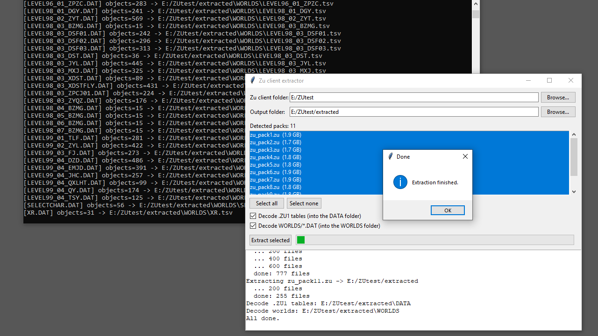

# zutools — Zu Online client extractor

Reverse-engineered toolkit for the *Zu Online / 新蜀山OL* client archives.



## Layout

| file | purpose |
|---|---|
| `zucrypto.py` | ChaCha20 (archive seal), RC4 (`.zu1`), LZO1X decompressor |
| `zurez.py`    | `.zu` archive reader/extractor (ChaCha20 + LithTech REZ) |
| `zudata.py`   | `.zu1` data-table decoder + table dumpers |
| `zuworld.py`  | `WORLDS/*.DAT` LithTech object parser |
| `zumaps.py`   | `MAPS/` converter (`*_MINIMAP.ZU3` -> `.jpg`, `*_HEIGHTMAP.ZU2` -> `.bmp`) |
| `zulua.py`    | `Rar!lua!` Lua decryptor (DES, key `BUF12SIZ`) |
| `zucook.py`   | post-extract finalize: decrypt Lua + decode tables/worlds/maps in place |
| `extract_all.py` | one-shot orchestration |
| `gui.py`      | Tkinter front-end (pick client folder -> pick packs -> extract) |

See [`docs/FORMATS.md`](docs/FORMATS.md) for the binary format reference and the
hardcoded keys, and [`AGENTS.md`](AGENTS.md) for the maintainer/agent guide.

## Usage

```powershell
# list / extract an archive (optionally filter by path prefix)
python zurez.py list   zu_pack1.zu
python zurez.py extract zu_pack1.zu out\pack1            # everything
python zurez.py extract zu_pack1.zu out\pack1 /MAPS,/DATA,/WORLDS

# .zu1 tables -> TSV (auto layout) or raw decode; TSVs land beside the sources
python zudata.py dumpall path\to\DATA path\to\DATA
python zudata.py decode  DATA\ITEMS.ZU1 out\ITEMS.bin

# world files -> object/position TSV; TSVs land beside the sources
python zuworld.py dumpall path\to\WORLDS path\to\WORLDS

# map images -> .jpg / .bmp beside the sources
python zumaps.py dumpall path\to\MAPS path\to\MAPS

# turn an extracted tree into original-format files (Lua plaintext, tables,
# worlds, map images) in place — or extract + finalize in one shot
python zucook.py path\to\extracted
python extract_all.py --pack zu_pack1.zu --out out

# graphical front-end: choose the client folder, tick the packs, extract
python gui.py
```

Requires Python 3.8+ only (no third-party packages).
